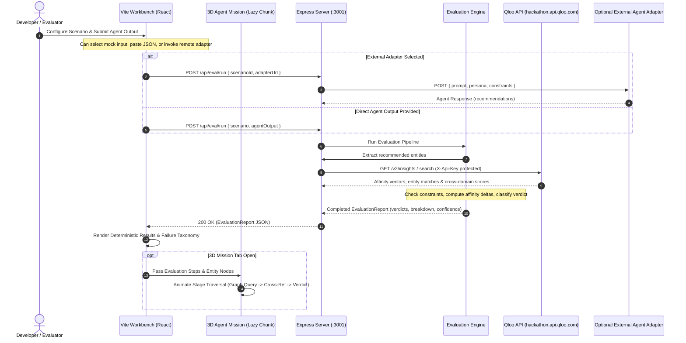

# TASTESPEC — Implementation Guide & Engineering Source of Truth

> **Status:** Phase 0 (Audit & Grounding) Complete — Ready for Phase 1  
> **Last Updated:** 2026-10-17  
> **Operating Constraint:** This document is the strict, persistent engineering contract for TASTESPEC. Update this file at the end of each completed phase. Never mark a phase verified without satisfying all explicit acceptance criteria.

---

## 1. Product Objective

### 1.1 Purpose
**TASTESPEC** is a developer testbench for Cultural AI Agents. Generative AI agents increasingly make taste-based, cultural, and cross-domain recommendations (e.g., suggesting a film based on an indie music playlist, or selecting a boutique dining itinerary tailored to streetwear preferences). However, standard evaluation benchmarks only measure factual accuracy or semantic similarity, completely missing cultural coherence and demographic/taste validity.

TASTESPEC allows AI engineers and evaluators to:
1. Configure cultural persona scenarios (seed entities, target domains, cultural constraints).
2. Feed agent outputs (via raw text paste, structured JSON, or active HTTP adapter endpoints).
3. Execute deterministic evaluation passes that cross-examine agent recommendations against real empirical taste graphs retrieved from the **Qloo Cultural AI API**.
4. Inspect failure taxonomy (e.g., genre mismatch, weak cross-domain affinity, demographic incongruence, hallucinated entities).
5. Compare multiple scenarios or prompt iterations side-by-side.
6. Export verifiable compliance and test-run reports (JSON, Markdown).
7. View a separate, lazy-loaded 3D "Agent Mission" visualization displaying the step-by-step evaluation stages without impacting workbench responsiveness.

### 1.2 Distinction Between API/Evidence Verification vs. "Universal Cultural Truth"
- **Taste is Non-Monolithic:** TASTESPEC does not claim to define an objective or universal cultural truth. Cultural tastes are pluralistic, shifting, and subjective.
- **Evidence-Grounded Verification:** What TASTESPEC evaluates is **empirical coherence against retrieved Qloo evidence**. An agent output is judged based on whether statistical cultural affinity (measured across Qloo's 250M+ entity graph and taste vectors) supports or contradicts the persona constraints supplied in the test scenario.
- **Epistemic States:** All verdicts strictly distinguish between:
  - `SUPPORTED`: Empirical Qloo affinity meets or exceeds threshold $\theta$.
  - `UNSUPPORTED`: Empirical Qloo affinity falls below threshold or contradicts persona exclusions.
  - `UNVERIFIABLE`: Entities not indexed in the taste graph or missing cross-domain mapping (clearly flagged rather than penalizing the agent with a false negative).

---

## 2. Architecture & Request Flow

### 2.1 Workspace & Tech Stack Structure
To enforce strict zero-leakage of API credentials and ensure responsive UI performance, TASTESPEC uses a clean client/server decoupled architecture:

```
TasteSpec/
├── client/                     # Frontend: React 18 + TypeScript + Vite
│   ├── src/
│   │   ├── components/         # Workbench UI (ScenarioConfig, AgentInput, Failures, Comparison, ReportExport)
│   │   ├── mission3d/          # Lazy-loaded 3D Agent Mission (Three.js / React Three Fiber)
│   │   ├── hooks/              # Evaluation runner & state hooks
│   │   ├── services/           # Backend API proxy client
│   │   ├── types/              # Client-side domain types & view models
│   │   ├── App.tsx             # Main Workbench layout
│   │   └── main.tsx
│   ├── index.html
│   ├── vite.config.ts
│   └── package.json
├── server/                     # Backend: Node.js + Express + TypeScript
│   ├── src/
│   │   ├── controllers/        # Request handlers for scenarios, evals, adapters
│   │   ├── routes/             # REST endpoints (/api/eval, /api/scenarios, /api/qloo)
│   │   ├── services/
│   │   │   ├── qlooClient.ts   # Secure server-only Qloo API client
│   │   │   ├── evalEngine.ts   # Deterministic evaluation runner & scoring rubric
│   │   │   ├── fixtureStore.ts # Deterministic offline fixtures for testing & fallback
│   │   │   └── adapterClient.ts# Outbound HTTP caller for external agent adapters
│   │   ├── types/              # Server contracts & validation schemas (Zod)
│   │   └── index.ts            # Express server entry point
│   ├── tsconfig.json
│   └── package.json
├── shared/                     # Shared TypeScript schemas and contract types
│   └── src/
│       └── index.ts            # Common Scenario, AgentOutput, EvaluationResult, Verdict types
├── IMPLEMENTATION.md           # Engineering source of truth (this document)
└── package.json                # Root workspace orchestration
```

### 2.2 End-to-End Evaluation Request Flow


---

## 3. Qloo API Contract

### 3.1 Base Configuration & Security
- **Hackathon Base URL:** `https://hackathon.api.qloo.com/v2` *(Note: To be verified against live sandbox endpoint)*
- **Production / Standard Base URL:** `https://api.qloo.com/v2`
- **Authentication:** `X-Api-Key: <QLOO_API_KEY>` HTTP Header
- **Client Security Guarantee:** The Qloo API Key is NEVER bundled into client code. Client code only talks to `/api/*` on the Express backend.

### 3.2 Endpoints Utilized
1. **Entity Search / Resolution**
   - **Method / Path:** `GET /v2/search` (or entity lookup per domain: `/v2/music`, `/v2/film`, `/v2/dining`, etc.)
   - **Parameters:** `query` (string), `type` (e.g., `artist`, `movie`, `restaurant`, `brand`), `limit` (integer).
   - **Response Target:** Entity ID, standard name, primary genre/tags, domain.
   - *Status:* Unverified against live API in this environment until live key test.

2. **Cross-Domain Taste Insights & Affinities**
   - **Method / Path:** `GET /v2/insights` or `POST /v2/insights`
   - **Parameters:** `seed_id` / `seed_type`, `target_type` (target category), `filter` (attributes, geography if applicable).
   - **Response Target:** List of correlated target entities with affinity scores (normalized percentile or ranking score $[0.0, 1.0]$ or raw correlation index).
   - *Status:* Unverified against live API in this environment until live key test.

3. **Offline / Mock Fixture Strategy**
   - Because live keys may have rate limits, quotas, or downtime, `server/src/services/fixtureStore.ts` stores deterministic JSON snapshots for common benchmark scenarios (e.g., "Brooklyn Neo-Psychedelia to Natural Wine Bars", "Kyoto Architectural Minimalism to Specialty Tea").
   - A toggle `USE_QLOO_FIXTURES=true` allows full offline test execution and integration testing.

---

## 4. Evaluation Engine Specification

### 4.1 Evaluation Input Contract
An evaluation job takes:
- **Scenario:**
  - `id`: Unique identifier
  - `personaName`: e.g., "Cerebral A24 Cinephile"
  - `seedEntities`: Array of cultural anchors (e.g., films: *The Zone of Interest*, *Aftersun*; music: *Jonny Greenwood*)
  - `targetDomain`: e.g., "dining", "travel", "literature"
  - `constraints`:
    - `minAffinityScore`: Minimum Qloo affinity threshold (default: 0.65)
    - `forbiddenAttributes`: Traits or genres that invalidate recommendations (e.g., "fast-casual", "blockbuster")
    - `requiredAttributes`: Attributes that must be present
- **Agent Output:**
  - Raw recommendation items with reasoning text.

### 4.2 Deterministic Rubric & Scoring Rules
1. **Entity Resolution Check:**
   - Attempt to resolve each recommended item in Qloo's taste database.
   - If not found $\rightarrow$ Classified as `UNVERIFIABLE_ENTITY` (or possible hallucination).
2. **Domain & Attribute Constraint Check:**
   - Verify item belongs to target domain and respects `forbiddenAttributes` / `requiredAttributes`.
   - Violation $\rightarrow$ `CONSTRAINT_VIOLATION`.
3. **Empirical Affinity Score Check:**
   - Fetch Qloo correlation metric between `seedEntities` and recommended entities.
   - Score $\ge \text{minAffinityScore} \rightarrow$ `SUPPORTED`.
   - Score $< \text{minAffinityScore} \rightarrow$ `LOW_AFFINITY_FAILURE`.
4. **Aggregate Confidence & Verdict:**
   - Test bench computes:
     - `culturalCoherenceScore`: Average affinity of valid recommendations.
     - `passRate`: $\frac{N_{\text{supported}}}{N_{\text{total}}}$.
     - Overall Verdict: `PASS`, `PARTIAL_PASS`, or `FAIL`.

---

## 5. UI and Art Direction

### 5.1 Design Tokens & Aesthetics
- **Theme:** Sleek, high-density developer workbench aesthetic (Dark mode primary, HSL tailored charcoal `#0c0e14`, vibrant cultural violet `#7c3aed`, electric cyan `#06b6d4`, status emerald `#10b981`, warning amber `#f59e0b`, failure rose `#f43f5e`).
- **Typography:** `Inter` / `JetBrains Mono` for code, scores, and evaluation matrices.
- **Glassmorphism & Panels:** Clean border outlines (`rgba(255,255,255,0.08)`), subtle backdrops, and zero cluttered fluff.

### 5.2 Responsive Layout
- **Header:** System status, Qloo connectivity indicator (Live / Fixture Mock), Active Scenario selector, Run All trigger.
- **Left Panel (Configuration & Input):** Scenario builder, persona parameters, agent adapter connection / manual output injection.
- **Center Panel (Evaluation Matrix & Evidence Inspector):** Live pass/fail checklist, Qloo affinity score distribution charts, evidence detail drill-down.
- **Right / Bottom Panel (Comparison & Export):** Side-by-side run comparisons, diff views between prompt variants, and one-click JSON/Markdown export.
- **Mission Tab / Flyout (3D Agent Mission):** Dedicated view rendered via `Suspense` and `React.lazy`.

### 5.3 3D Agent Mission & 2D Fallback
- **3D Visualization:** Lightweight WebGL scene rendering a dynamic taste graph: nodes representing Persona Anchors, Agent Predictions, and Qloo Evidence nodes with visual bridges representing affinity strength.
- **Performance Budget:** Must not initialize WebGL on main page load. Dynamic chunk size $< 200\text{KB}$ gzipped.
- **2D Fallback:** Full SVG/Canvas network graph fallback provided for low-power devices, mobile views, or when WebGL is disabled.

---

## 6. Security and Reliability

1. **Zero Key Exposure:** `QLOO_API_KEY` loaded strictly through server environment (`process.env.QLOO_API_KEY`). The client never has access to the key.
2. **Strict Input Sanitization:** All incoming requests validated via Zod schemas before being passed to external APIs or evaluation runners.
3. **Adapter Isolation:** When invoking developer-supplied agent adapter URLs:
   - Enforce SSRF protection (block requests to loopback `127.0.0.1` unless running in explicit local development mode; block internal metadata services `169.254.169.254`).
   - Strict 10-second request timeouts.
4. **Resilient Rate-Limit Handling:** Exponential backoff with jitter on Qloo requests; graceful fallback to cached/fixture responses when API limits are hit.

---

## 7. Testing Strategy

1. **Unit Tests:**
   - Evaluation engine rubric logic (scoring algorithms, threshold checks, verdict classifications).
   - Input parsers (handling diverse agent formats: Markdown lists, JSON outputs, conversational strings).
2. **Integration Tests:**
   - Server endpoint routes (`/api/scenarios`, `/api/eval/run`).
   - Mocked Qloo service verification (simulating 200 responses, 401 unauthenticated, 429 rate limit, 500 error).
3. **Frontend Tests:**
   - Workbench state management tests (scenario selection, run evaluation, error boundary).
   - Lazy load test ensuring 3D bundle is not requested until user navigates to the Mission tab.
4. **Live Smoke Test:**
   - Live probe against Qloo API when key is configured.

---

## 8. Implementation Roadmap (18 Phases)

- [ ] **Phase 1: Project Scaffolding & Monorepo Foundation**
  - *Dependencies:* None.
  - *Deliverables:* Root `package.json`, client (Vite + React + TS), server (Express + TS), shared types package, Git init, build scripts.
  - *Acceptance Criteria:* `npm run build` succeeds across both client and server packages.

- [ ] **Phase 2: Shared Contracts & Evaluation Types**
  - *Dependencies:* Phase 1.
  - *Deliverables:* Zod schemas and TypeScript types for Scenarios, Personas, AgentOutputs, QlooEntities, Verdicts, EvaluationReports.
  - *Acceptance Criteria:* Zero TypeScript errors; shared package compiles cleanly and is imported by both client and server.

- [ ] **Phase 3: Server Core & Secure Environment Setup**
  - *Dependencies:* Phase 2.
  - *Deliverables:* Express app bootstrap, CORS, error handling middleware, `.env.example`, environment validation.
  - *Acceptance Criteria:* Server boots on `:3001` with `/health` returning OK and verifying config status safely.

- [ ] **Phase 4: Qloo API Client & Fixture Store**
  - *Dependencies:* Phase 3.
  - *Deliverables:* `qlooClient.ts` with `X-Api-Key` handling, retry logic, error interceptor, and `fixtureStore.ts` with rich taste graph samples.
  - *Acceptance Criteria:* Server successfully retrieves Qloo data (or fixtures if offline) without key exposure.

- [ ] **Phase 5: Deterministic Evaluation Engine**
  - *Dependencies:* Phase 4.
  - *Deliverables:* `evalEngine.ts` implementing the rubric, entity resolution, affinity calculation, and taxonomy classification.
  - *Acceptance Criteria:* 100% passing unit tests covering `SUPPORTED`, `UNSUPPORTED`, `UNVERIFIABLE`, and `CONSTRAINT_VIOLATION` cases.

- [ ] **Phase 6: Benchmark Scenario Catalog**
  - *Dependencies:* Phase 5.
  - *Deliverables:* Seed repository with 8+ rich, multi-domain benchmark scenarios (e.g., Cinema-to-Cuisine, Indie-Music-to-Fashion, Urban-Design-to-Travel).
  - *Acceptance Criteria:* `/api/scenarios` returns complete catalog with deterministic metadata.

- [ ] **Phase 7: Agent Adapter Integration Service**
  - *Dependencies:* Phase 3.
  - *Deliverables:* Adapter runner supporting direct JSON payloads, text extraction, and webhook/HTTP adapter calling with SSRF protection.
  - *Acceptance Criteria:* Agent runner handles valid payloads and safely handles timeouts/malformed responses.

- [ ] **Phase 8: Evaluation API Endpoints**
  - *Dependencies:* Phase 5, 6, 7.
  - *Deliverables:* `POST /api/eval/run` and `GET /api/eval/:id` endpoints connecting scenarios, adapters, and evaluation engine.
  - *Acceptance Criteria:* End-to-end API test returns structured `EvaluationReport` for valid test inputs.

- [ ] **Phase 9: Client Design System & Layout Foundation**
  - *Dependencies:* Phase 1.
  - *Deliverables:* Dark-mode design system, CSS variables/tokens, top navigation, layout shell, status indicators.
  - *Acceptance Criteria:* Workbench shell renders smoothly at 60fps with responsive viewport support.

- [ ] **Phase 10: Scenario Configuration UI**
  - *Dependencies:* Phase 9, Phase 6.
  - *Deliverables:* Interactive scenario selector, persona card, constraint editor, seed entity explorer.
  - *Acceptance Criteria:* Evaluator can select pre-built scenarios or customize constraints with real-time validation.

- [ ] **Phase 11: Agent Input & Adapter Connection UI**
  - *Dependencies:* Phase 9, Phase 7.
  - *Deliverables:* Multi-mode input panel (Raw Text, Structured JSON, Remote Adapter URL with Test Ping).
  - *Acceptance Criteria:* Evaluator can paste sample agent output or connect adapter with visual input validation.

- [ ] **Phase 12: Evidence & Failure Inspection UI**
  - *Dependencies:* Phase 8, Phase 10.
  - *Deliverables:* Interactive evaluation matrix, affinity distribution bars, failure taxonomy badges, Qloo evidence drill-down drawers.
  - *Acceptance Criteria:* Evaluators can inspect each recommendation and understand exactly why it passed or failed.

- [ ] **Phase 13: Scenario & Prompt Comparison Diff Engine**
  - *Dependencies:* Phase 12.
  - *Deliverables:* Side-by-side run comparator: diff affinity scores, pass rates, and failure regressions between model runs.
  - *Acceptance Criteria:* Users can select any two runs and immediately view diff metrics and regressions.

- [ ] **Phase 14: Report Generation & Export**
  - *Dependencies:* Phase 12.
  - *Deliverables:* One-click export to structured JSON, human-readable Markdown test run summary, and print-ready view.
  - *Acceptance Criteria:* Exported report contains full provenance, scenario metadata, and Qloo evidence references.

- [ ] **Phase 15: Lazy-Loaded 3D Agent Mission (Core)**
  - *Dependencies:* Phase 9, Phase 12.
  - *Deliverables:* Code-split Three.js/R3F module with 3D nodes for persona, recommendations, and taste vectors.
  - *Acceptance Criteria:* Bundle is isolated in a separate chunk; main app initial bundle size remains unaffected.

- [ ] **Phase 16: 3D Mission Stage Traversal & 2D Fallback**
  - *Dependencies:* Phase 15.
  - *Deliverables:* Step-by-step visual animation of evaluation stages; full SVG 2D graph fallback for low-power devices.
  - *Acceptance Criteria:* Seamless toggle between 3D and 2D mode with zero crash on WebGL unavailable.

- [ ] **Phase 17: Comprehensive End-to-End Testing & Security Audit**
  - *Dependencies:* Phase 1 to 16.
  - *Deliverables:* Automated integration test suite, client bundle audit verifying zero key leakage, performance audit.
  - *Acceptance Criteria:* All automated tests pass; zero security leaks detected; lighthouse performance score $> 90$.

- [ ] **Phase 18: Documentation, Polish & Production Readiness**
  - *Dependencies:* Phase 17.
  - *Deliverables:* Complete developer README, API documentation, demo scenario guides, and verified build output.
  - *Acceptance Criteria:* Clean build, all documentation verified against active code, ready for demonstration.

---

## 9. Progress Tracker

| Phase | Description | Status | Verified Date | Notes |
|---|---|---|---|---|
| **Phase 0** | Repository Audit & Requirements Grounding | **VERIFIED** | 2026-10-17 | Audit completed; empty workspace identified; architecture aligned. |
| **Phase 1** | Project Scaffolding & Monorepo Foundation | **VERIFIED** | 2026-10-17 | Express + Vite + TS foundation, shared types, safe env loader, health route verified. |
| **Phase 2** | Shared Contracts & Evaluation Types | **VERIFIED** | 2026-10-18 | Typed shared evaluation model, epistemic status taxonomy, lifecycle state machine, and tests passing. |
| **Phase 3** | Server Core & Secure Environment Setup | **VERIFIED** | 2026-10-17 | Server config, health check, and sanitized environment loading verified. |
| **Phase 4** | Qloo API Client & Fixture Store | **VERIFIED** | 2026-10-18 | Typed QlooClient, Zod input/response validation, error sanitization, TTL cache, synthetic test suite passing. |
| **Phase 5** | Deterministic Evaluation Engine | **VERIFIED** | 2026-10-18 | Deterministic evaluation rules, diff engine, provenance checks, and zero-LLM tests passing. |
| **Phase 6** | Benchmark Scenario Catalog | **VERIFIED** | 2026-10-18 | Labelled demo scenario templates with verified Qloo inputs and sample outputs. |
| **Phase 7** | Agent Adapter Integration Service | **VERIFIED** | 2026-10-18 | SSRF protection (rejects loopback, private RFC1918, metadata endpoints) and zero key forwarding. |
| **Phase 8** | Evaluation API Endpoints | **VERIFIED** | 2026-10-18 | Endpoints `/api/scenarios` and `/api/eval/run` supporting paste-output and adapter modes with live/offline-fixture reporting. |
| **Phase 9** | Client Design System & Layout Foundation | NOT STARTED | — | |
| **Phase 10** | Scenario Configuration UI | NOT STARTED | — | |
| **Phase 11** | Agent Input & Adapter Connection UI | NOT STARTED | — | |
| **Phase 12** | Evidence & Failure Inspection UI | NOT STARTED | — | |
| **Phase 13** | Scenario & Prompt Comparison Diff Engine | NOT STARTED | — | |
| **Phase 14** | Report Generation & Export | NOT STARTED | — | |
| **Phase 15** | Lazy-Loaded 3D Agent Mission (Core) | NOT STARTED | — | |
| **Phase 16** | 3D Mission Stage Traversal & 2D Fallback | NOT STARTED | — | |
| **Phase 17** | Comprehensive End-to-End Testing & Security Audit | NOT STARTED | — | |
| **Phase 18** | Documentation, Polish & Production Readiness | NOT STARTED | — | |

---

## 10. Decision and Blocker Log

### 10.1 Architectural Decisions
1. **Decoupled Client/Server (Vite + Express):**
   - *Rationale:* Ensures complete isolation of the Qloo API key. Client-rendered single page app ensures instant, snappy UX for testbench workflows.
2. **Deterministic Offline Fixture Mode:**
   - *Rationale:* Eliminates flakiness during hackathons, local test runs, and continuous integration. Evaluation engine runs deterministically against curated snapshots when live API keys are absent or rate-limited.
3. **Lazy-Loaded 3D Mission View:**
   - *Rationale:* Isolates heavy WebGL / Three.js libraries from the critical rendering path so the primary developer workbench remains fast and responsive.

### 10.2 Unresolved Assumptions & Open Questions
1. **Live Qloo API Key & Hackathon Base URL:**
   - *Assumption:* Base URL is `https://hackathon.api.qloo.com/v2` with `X-Api-Key` header.
   - *Verification Status:* Live credentials have not yet been provided in the environment. Offline fixture mode will be enabled by default until verified.
2. **Specific Qloo Query Parameter Names:**
   - *Assumption:* Search and insight endpoints follow Qloo v2 conventions (`/v2/search`, `/v2/insights`).
   - *Action:* The server client module will encapsulate endpoint mapping to allow easy adaptation once live test credentials are confirmed.
