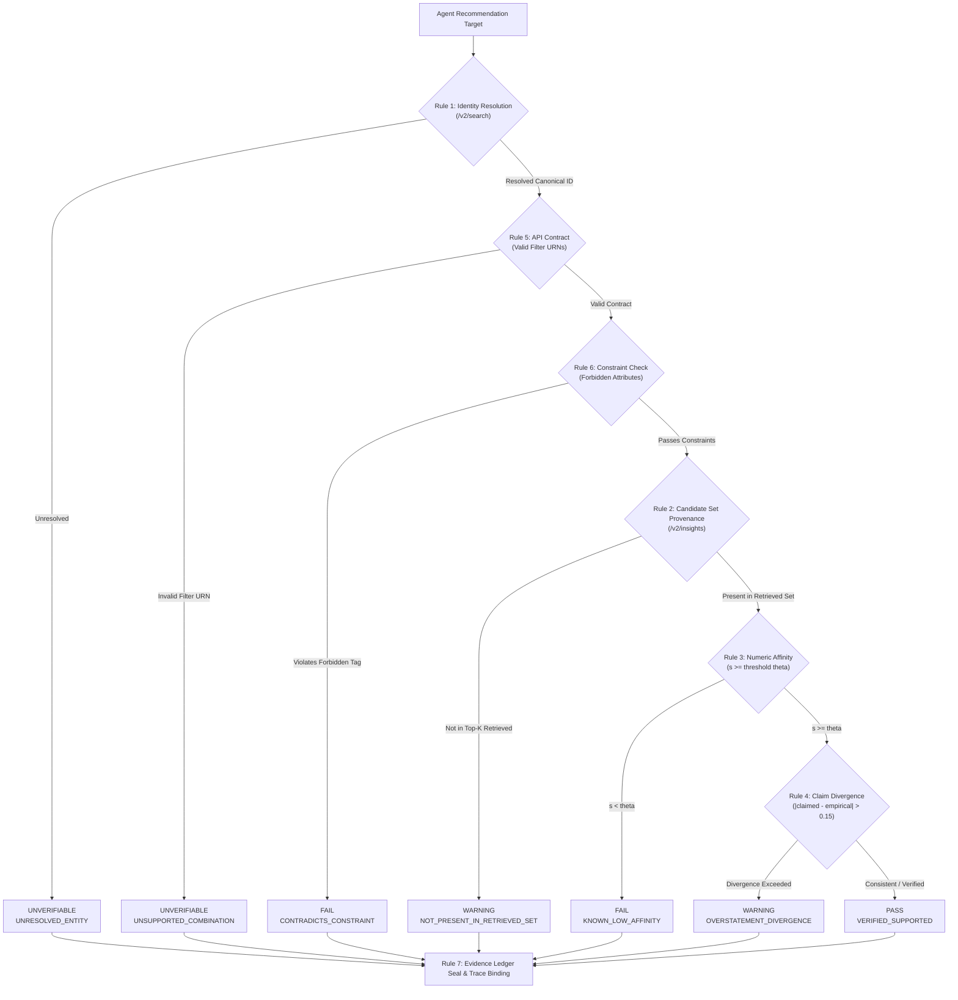

# TASTESPEC: Empirical Taste Grounding & Diagnostic Platform for Cultural AI Agents

[](https://qloo.com)
[](LICENSE)
[](https://www.typescriptlang.org)
[](#ssrf-protected-agent-adapters)

> **TASTESPEC** is an enterprise-grade evaluation benchmark and diagnostic testbench for Cultural AI Agents. It cross-examines agent recommendations against Qloo's 250M+ entity cultural intelligence graph using 7 deterministic mathematical audit rules, sealing every verdict into a verifiable evidence ledger.

---

## Table of Contents

1. [Problem vs Solution](#problem-vs-solution)
2. [Key Capabilities](#key-capabilities)
3. [The 7 Deterministic Audit Rules](#the-7-deterministic-audit-rules)
4. [System Architecture](#system-architecture)
5. [Installation & Quickstart](#installation--quickstart)
6. [Interactive 15-Second Guided Demo](#interactive-15-second-guided-demo)
7. [SSRF-Protected Agent Adapters](#ssrf-protected-agent-adapters)
8. [CLI & Development Commands](#cli--development-commands)
9. [MIT License](#mit-license)

---

## Problem vs Solution

### The Cultural Hallucination Problem
Large Language Models (LLMs) and autonomous recommendation agents regularly hallucinate cultural taste. When asked to recommend dining, music, cinema, literature, or fashion for nuanced subcultures, LLMs exhibit severe failure modes:

* **Plausible Fabrications:** Generating synthetic venue names, nonexistent artists, or shuttered establishments with authoritative tone.
* **Ungrounded Affinity Claims:** Inventing confidence scores (e.g., *"92% match for post-punk enthusiasts"*) without any statistical basis in real-world cultural consumption.
* **Stereotypical / Popularity Bias:** Collapsing niche subcultural aesthetics into mainstream cliches (e.g., equating Brooklyn neo-psychedelia with generic midtown bistros or commercial sports bars).
* **LLM-as-a-Judge Flaws:** Using an LLM to evaluate another LLM compounds epistemic drift, non-determinism, and hallucination loops.

### The TASTESPEC Solution
TASTESPEC replaces fuzzy LLM-as-a-judge evaluations with **deterministic grounding against Qloo's empirical taste graph** (250M+ global entities, 575B+ cross-domain affinity correlations):

```
+---------------------+      Recommendations       +-------------------------------+
|  Cultural AI Agent  | -------------------------> |  TASTESPEC Evaluation Engine  |
|  (LLM / Recommender)|                            +-------------------------------+
+---------------------+                                            |
                                            +----------------------+----------------------+
                                            |                      |                      |
                                            v                      v                      v
                                  [1. Resolve Entities]   [2. Fetch Vectors]   [3. Deterministic Audit]
                                     /v2/search API        /v2/insights API      7 Epistemic Math Rules
                                            |                      |                      |
                                            +----------------------+----------------------+
                                                                   |
                                                                   v
                                                      +-------------------------+
                                                      | Sealed Evidence Ledger  |
                                                      |  PASS / WARN / FAIL / ? |
                                                      +-------------------------+
```

1. **Zero Hallucination Tolerance:** Every recommendation target is independently verified against Qloo entity search.
2. **Empirical Vector Verification:** Affinities are cross-referenced with real consumer affinity vectors across music, film, dining, literature, and fashion.
3. **No Subjective Scoring:** Mathematical rules evaluate threshold compliance ($\theta \ge 0.65$), attribute violations, and divergence.
4. **Verifiable Ledger:** Every check traces to cryptographic hashes and timestamped evidence records.

---

## Key Capabilities

* **3D Cultural Core (Three.js / WebGL):** Real-time interactive revolving cultural hyper-sphere visualizing cross-domain affinity orbital nodes (Music, Film, Dining, Fashion).
* **Deterministic Workbench Console:** Dual-column evaluation console with real-time target scanner radar and expandable diagnostic narrative cards.
* **15-Second Guided Interactive Demo:** Built-in judge tour running live entity resolution, vector insight retrieval, and deterministic rule execution with instant mathematical proof display.
* **Evidence Ledger Slide-Over:** Deep-dive diagnostic drawer tracing every finding to exact raw JSON payloads, latencies, endpoints, and provenance.
* **Scenario Diff & Comparison:** Comparative regression workbench calculating item additions, removals, status transitions, and numerical score deltas across evaluation runs.
* **High-Contrast Apple/Vercel Day & Night Themes:** Responsive ambient gradient mesh system with frosted glassmorphism (`backdrop-blur-xl`), subpixel grids, and high-visibility status tokens.

---

## The 7 Deterministic Audit Rules

TASTESPEC enforces strict epistemic honesty. Findings are categorized into four deterministic statuses: `PASS`, `WARNING`, `FAIL`, and `UNVERIFIABLE`.



### 1. Rule 1: Entity Identity Resolution (`/v2/search`)
* **Purpose:** Validates that the agent's recommended target exists in physical reality and is cataloged within Qloo's knowledge graph.
* **Mechanism:** Queries Qloo `/v2/search` by name, domain, and location context.
* **Outcome:** If unresolved, evaluates to `UNVERIFIABLE` (`UNRESOLVED_ENTITY`). It is never penalized as negative affinity, maintaining epistemic honesty.

### 2. Rule 2: Candidate Set Provenance (`/v2/insights`)
* **Purpose:** Checks whether a known entity was surfaced in the empirical top-K affinity candidate set retrieved for the persona's input seeds.
* **Mechanism:** Intersects the resolved candidate ID against the insights output collection.
* **Outcome:** If resolved but absent from top-K results, evaluates to `WARNING` (`NOT_PRESENT_IN_RETRIEVED_SET`).

### 3. Rule 3: Numeric Affinity Verification
* **Purpose:** Verifies that empirical affinity meets or exceeds the scenario's mathematical threshold.
* **Mechanism:** Compares empirical affinity $s \in [0, 1]$ against minimum requirement $\theta$ (default $\theta = 0.65$):
  $$\text{Status} = \begin{cases} \text{PASS} & \text{if } s \ge \theta \\ \text{FAIL} & \text{if } s < \theta \end{cases}$$
* **Mathematical Proof:** Displays explicit empirical verification (e.g., *Verified Affinity 0.88 $\ge$ Scenario Threshold 0.65*).

### 4. Rule 4: Claim Divergence
* **Purpose:** Detects agent score overstatement or hallucinated confidence metrics.
* **Mechanism:** Calculates absolute divergence between agent claimed score ($s_{\text{claim}}$) and Qloo empirical score ($s_{\text{emp}}$):
  $$\Delta = |s_{\text{claim}} - s_{\text{emp}}|$$
* **Outcome:** If $\Delta > 0.15$, flags a `WARNING` with the exact score delta to expose agent exaggeration.

### 5. Rule 5: API Contract Enforcement
* **Purpose:** Ensures queries use only documented, verified Qloo URN filter combinations (e.g., `urn:entity:place`, `urn:entity:artist`).
* **Mechanism:** Validates constraint schemas prior to API execution.
* **Outcome:** Speculative or unsupported URN combinations yield `UNVERIFIABLE` (`UNSUPPORTED_COMBINATION_OR_MISSING_EVIDENCE`) rather than making illegal requests.

### 6. Rule 6: Constraint Contradiction & Coverage
* **Purpose:** Enforces persona boundaries, dietary exclusions, geographic radii, and forbidden attributes.
* **Mechanism:** Inspects entity tags against scenario `forbiddenAttributes` (e.g., `commercial_sports_bar`).
* **Outcome:** Matches produce a critical `FAIL` (`CONTRADICTS_CONSTRAINT`).

### 7. Rule 7: Evidence Ledger Integrity
* **Purpose:** Cryptographically seals evaluation findings into a tamper-evident audit ledger.
* **Mechanism:** Validates that every finding links to recorded ledger entries (`referencedLedgerIds`), verifying origin URIs, latencies, and payload origins without fabricated metrics.

---

## System Architecture

```
TasteSpec/
├── client/                     # Frontend Application (React 18 + Vite + Tailwind CSS)
│   ├── src/
│   │   ├── components/         # Views: LandingHeroView, TestbenchView, Mission3DView, etc.
│   │   ├── components/common/  # Reusable: AppHeader, AuditTable, EvidenceDrawer, etc.
│   │   ├── data/               # High-fidelity offline demo fixtures & fallback scenarios
│   │   └── index.css           # Custom glassmorphism, cyber neon tokens, day/night themes
│   └── vite.config.ts          # Vite build config with /api dev proxy
├── server/                     # Backend API Service (Node.js + Express + TypeScript)
│   ├── src/
│   │   ├── services/
│   │   │   ├── qlooClient.ts   # Resilient Qloo API v2 client with in-memory caching
│   │   │   ├── evalEngine.ts   # Deterministic 7-rule mathematical evaluation engine
│   │   │   ├── agentAdapter.ts # SSRF-protected remote agent caller (HTTPS only)
│   │   │   └── evalRunnerService.ts # Multi-stage evaluation workflow orchestrator
│   │   ├── config.ts           # Safe environment config loader
│   │   └── index.ts            # Express server entry point
├── shared/                     # Shared TypeScript Contracts & Schemas
│   ├── src/
│   │   ├── evaluationModel.ts  # Zod schemas for Scenarios, Reports, and Findings
│   │   └── evidenceLedger.ts   # Evidence ledger record schemas and integrity checkers
└── test/                       # Comprehensive Test Suite (tsx --test)
    ├── evalEngine.test.ts      # Deterministic rule unit tests (Rules 1-7)
    ├── qlooClient.test.ts      # Qloo client caching, timeouts, and error handling
    ├── agentAdapter.test.ts    # SSRF protection and URL validation tests
    └── integrity.test.ts       # Cryptographic evidence ledger validation tests
```

---

## Installation & Quickstart

### Prerequisites
* **Node.js**: `v18.x` or higher (Node 20+ recommended)
* **npm**: `v9.x` or higher
* **Qloo API Key**: Obtain from [Qloo Developer Portal](https://qloo.com) *(optional: high-fidelity offline fixture mode operates automatically if key is omitted)*

### 1. Clone Repository
```bash
git clone https://github.com/your-org/tastespec.git
cd tastespec
```

### 2. Install Dependencies
```bash
npm install
```

### 3. Configure Environment Variables
Create a `.env` file in the root directory:
```bash
cp .env.example .env
```
Edit `.env` to include your Qloo API key:
```env
PORT=3001
NODE_ENV=development
QLOO_API_BASE_URL=https://staging-api.qloo.com
QLOO_API_KEY=your_qloo_api_key_here
```

> **Note:** If `QLOO_API_KEY` is not provided, TASTESPEC automatically runs in **Offline Fixture Mode**, enabling full evaluation testing with realistic Brooklyn and Tokyo culture vectors.

### 4. Start Development Servers
Start both the backend server (port 3001) and Vite frontend (port 5173) concurrently:
```bash
npm run dev
```
Open **[http://localhost:5173](http://localhost:5173)** in your browser.

---

## Interactive 15-Second Guided Demo

TASTESPEC includes an automated 15-second guided demo engine built for judges, auditors, and technical evaluators:

1. Click **"▶ Run 15-Second Guided Demo"** in the top testbench bar.
2. An interactive telemetry overlay tracks real-time execution:
   * **[00s - 05s] STAGE 1: RESOLVING ENTITIES:** Queries target candidates (*The Four Horsemen*, *Ten Bells*) against Qloo `/v2/search`.
   * **[05s - 10s] STAGE 2: FETCHING VECTOR EVIDENCE:** Queries empirical affinity vectors against persona seeds (*Stereolab*, *Crumb*) via `/v2/insights`.
   * **[10s - 15s] STAGE 3: EXECUTING DETERMINISTIC RULES:** Evaluates threshold compliance ($\theta \ge 0.65$) and checks for constraint contradictions.
3. Upon completion, the overlay presents a **100% Pass Rate** summary.
4. Clicking **"Inspect Mathematical Proof Below →"** centers and illuminates the diagnostic card with empirical mathematical proof:
   $$\text{Verified Affinity } 0.88 \ge \text{Scenario Threshold } 0.65$$

---

## SSRF-Protected Agent Adapters

When testing live agent endpoints, TASTESPEC enforces strict **Server-Side Request Forgery (SSRF) protection** ([`agentAdapter.ts`](file:///Users/akul/Desktop/TasteSpec/server/src/services/agentAdapter.ts)):

* **Protocol Enforcement:** Only secure `https://` URLs are permitted.
* **Loopback & Localhost Rejection:** Blocks `localhost`, `127.0.0.1`, `::1`, and `.local` hostnames.
* **Cloud Metadata Blocking:** Rejects `169.254.169.254`, `metadata.google.internal`, and AWS/GCP/Azure link-local endpoints.
* **RFC1918 Private Subnet Rejection:** Prohibits connections to private IP spaces (`10.0.0.0/8`, `172.16.0.0/12`, `192.168.0.0/16`).

---

## CLI & Development Commands

| Command | Description |
| :--- | :--- |
| `npm run dev` | Starts Express backend and Vite frontend concurrently |
| `npm run dev:server` | Starts Express server with hot-reload via `tsx watch` |
| `npm run dev:client` | Starts Vite client dev server |
| `npm run type-check` | Type-checks client, server, and shared workspaces with `tsc` |
| `npm test` | Runs comprehensive test suite (66+ unit and integration tests) |
| `npm run test:smoke` | Runs live Qloo API smoke test against `/v2/search` and `/v2/insights` |
| `npm run build` | Builds production client bundle and compiles server |
| `npm start` | Launches compiled production Express server |

---

## MIT License

```text
MIT License

Copyright (c) 2026 TASTESPEC Contributors

Permission is hereby granted, free of charge, to any person obtaining a copy
of this software and associated documentation files (the "Software"), to deal
in the Software without restriction, including without limitation the rights
to use, copy, modify, merge, publish, distribute, sublicense, and/or sell
copies of the Software, and to permit persons to whom the Software is
furnished to do so, subject to the following conditions:

The above copyright notice and this permission notice shall be included in all
copies or substantial portions of the Software.

THE SOFTWARE IS PROVIDED "AS IS", WITHOUT WARRANTY OF ANY KIND, EXPRESS OR
IMPLIED, INCLUDING BUT NOT LIMITED TO THE WARRANTIES OF MERCHANTABILITY,
FITNESS FOR A PARTICULAR PURPOSE AND NONINFRINGEMENT. IN NO EVENT SHALL THE
AUTHORS OR COPYRIGHT HOLDERS BE LIABLE FOR ANY CLAIM, DAMAGES OR OTHER
LIABILITY, WHETHER IN AN ACTION OF CONTRACT, TORT OR OTHERWISE, ARISING FROM,
OUT OF OR IN CONNECTION WITH THE SOFTWARE OR THE USE OR OTHER DEALINGS IN THE
SOFTWARE.
```
